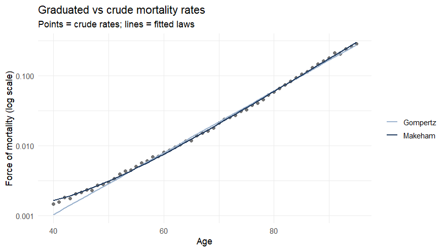
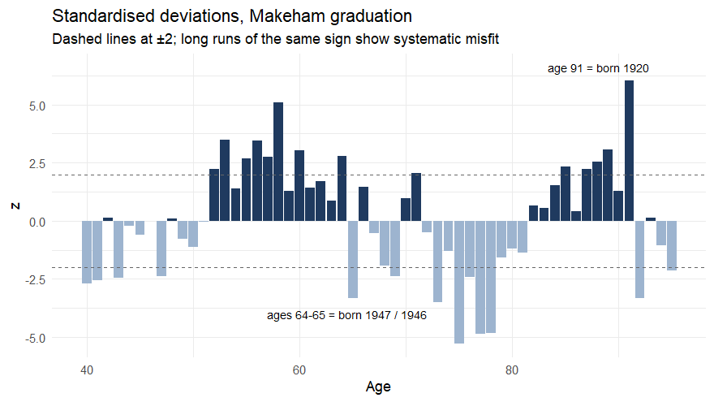

# Mortality Modelling and Life Table Construction (R)

From raw deaths and exposure data to priced life insurance products: fitting the **Gompertz** and **Makeham**
mortality laws by **hand-coded maximum likelihood**, testing the fit with actuarial **graduation tests**,
building a **life table**, and pricing **annuities** and **term assurance**.

**Full analysis with code and charts → [analysis.md](analysis.md)**



## Data

Real deaths and central exposures for **England & Wales males, 2011, ages 40–95** (about 221,000 deaths,
13.2 million person-years), from the [Human Mortality Database](https://www.mortality.org) as packaged in the
R package [`StMoMo`](https://cran.r-project.org/package=StMoMo).

## Method

1. **Crude rates** $\hat m_x = D_x/E_x$.
2. **Poisson likelihood** $D_x \sim \text{Poisson}(E_x\mu_x)$, maximised with `optim()` using the analytic
   gradient. Standard errors come from the inverse Hessian. The Gompertz fit is cross-checked against `glm()`
   and agrees to within 10⁻⁹.
3. **Model comparison** with AIC and a likelihood-ratio test (Makeham vs Gompertz).
4. **Graduation tests:** chi-square, standardised deviations, signs, cumulative deviations, grouping of signs.
5. **Life table** to age 110 using exact one-year probabilities: $q_x = 1-\exp(-\int_x^{x+1}\mu_t\,dt)$.
6. **Pricing at 4%:** whole-life annuity-due, 20-year term assurance, and level premium by the equivalence principle.
7. **Sensitivity** of the age-65 annuity to interest (3–5%) and mortality (±10%).

## Key findings

| Finding | Result |
|---|---|
| Better law | **Makeham** ($A=0.00088$, $c=1.115$): LRT = 883 on 1 df vs Gompertz |
| Rate of ageing | Mortality rises about **11.5% per year of age** |
| Graduation tests | Overall bias tests **pass**; chi-square and grouping-of-signs **fail** on national-scale data |
| Why they fail | Long runs of misfit, plus **cohort effects**: largest deviation at age 91 (born 1920, post-WWI birth spike), and a jump at 64/65 (born 1947 vs 1946) |
| Same model at insurer scale (1% of data) | χ² = 3.4 on 53 df: **passes** |
| Life expectancy | 39.9 years at age 40; 22.0 at age 60 |
| Annuity-due at 65, 4% | **12.70**, so a pension of 10,000 a year costs about 127,000 |
| 20-year term assurance, age 40, sum assured 1,000,000 | Level annual net premium about **3,100** |
| Sensitivity | 1% lower interest raises the annuity cost **~9%**; 10% lighter mortality **~3%** |



## What I learned

* Coding the likelihood by hand shows what `glm()` does internally. It also shows why the **analytic gradient
  matters**: the two Gompertz parameters are highly correlated, and with numerical gradients alone the
  optimiser stopped short of the true MLE.
* **Statistically significant isn't the same as financially material.** With over 200,000 deaths, any simple
  law fails a chi-square test. The actuarial question is whether the misfit changes prices or reserves.
* Graduation tests catch real-world features of the data, here birth-cohort effects, that a single good-looking
  chart would hide.

## Limitations and next steps

* **Population vs insured lives:** insured lives live longer, and there are select effects. For India the
  relevant table is **IALM 2012–14**.
* **No mortality improvements:** add projections (Lee–Carter or CBD models via `StMoMo`).
* Net premiums only: no expenses, profit or lapses.

## How to run

```r
source("install.R")                 # installs the required packages
rmarkdown::render("analysis.Rmd")   # recreates analysis.md and the figures
```

Built with R 4.6, using `StMoMo` (data only), `ggplot2`, `scales` and `rmarkdown`. The model code is in
[`R/mortality_functions.R`](R/mortality_functions.R).

---
*Author: [Hemant Pareek](https://github.com/hemantpareek-02) · Aspiring actuarial analyst (IAI: ACET → CS1)*
